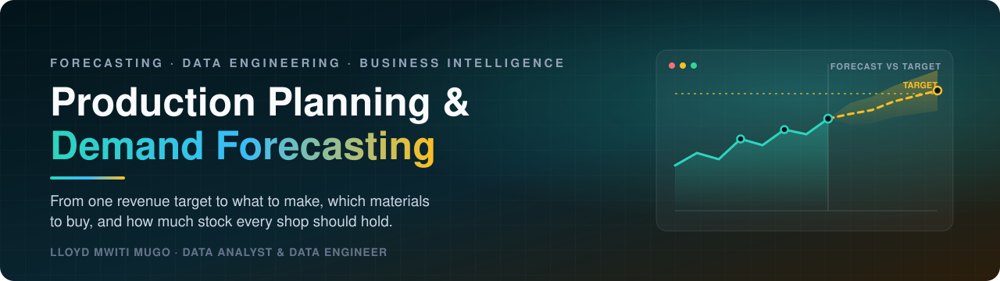
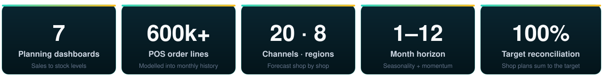
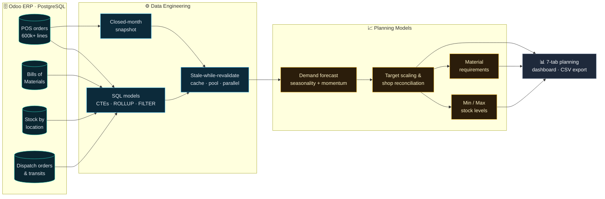

<div align="center">



<br/>


**Designed and built end to end by [Lloyd Mwiti Mugo](https://www.linkedin.com/in/lloyd-mwiti-mugo-94066a243/)**

[Overview](#-overview) · [Architecture](#-architecture) · [Forecasting](#-the-forecasting-model) · [Inventory](#-from-forecast-to-factory-floor-and-shop-shelf) · [Engineering](#-data-engineering) · [Hard Problems](#-hard-problems-solved) · [Dashboards](#-what-the-dashboard-delivers) · [Contact](#-about-me)

</div>

---

## 🧭 Overview

Denri designs and manufactures bags and sells them through **20 retail and online channels across 8 regions**. Each month, management sets one number: a **revenue target**. Turning that number into action raised questions nobody could answer from the ERP:

> *How many of each bag do we need to sell? How many must the factory make? How many metres of lining, zips and sliders must we buy? What should each shop be stocked with, and is it on track this month?*

I built a planning platform that answers all of them from live data. It reads POS orders, Bills of Materials, multi-location stock and dispatch records straight from **Odoo's PostgreSQL database**. It forecasts demand per product and per shop, scales the forecast to the target, breaks it down into raw materials, and sets daily min/max stock levels for every outlet.

<p align="center"></p>

> [!NOTE]
> This is a **portfolio showcase**. The source code and all business data are private to the company. This repository documents the design, the modelling and the problems solved.

---

## 🏗 Architecture



---

## 📈 The Forecasting Model

A transparent model that the business can audit. Every number on screen can be traced back to its inputs.

<table>
<tr>
<td width="50%" valign="top">

### 1 · Baseline: seasonality + momentum
For each product and each forecast month:

```
baseline = ½ × (same month last year)
         + ½ × (avg of last 3 completed months)
```

Last year's month captures **seasonality**. The trailing three months capture **current momentum**. The plan can cover **1–12 consecutive months** and rolls over year boundaries correctly.

</td>
<td width="50%" valign="top">

### 2 · Scale to the revenue target
```
growth rate   = target ÷ Σ(baseline × avg price)
product units = baseline × growth rate
```

One growth factor keeps each product's share of the forecast while hitting the target exactly. Average prices use **full-price sales only**, so bundle components priced near zero don't drag them down.

</td>
</tr>
<tr>
<td valign="top">

### 3 · Cold start for new products and shops
A product launched three months ago has *no* "same month last year". Blending in that zero would **halve its forecast**. New entities are detected automatically and their missing history is estimated in steps:

`product's regional peers` → `region overall` → `whole portfolio`

applied to the entity's own recent sales.

</td>
<td valign="top">

### 4 · Hierarchical reconciliation
Each shop is forecast from its own history, but independent shop forecasts didn't add up to the company plan: they overshot by **~10%**. A single reconciliation factor now makes shop targets sum to **exactly the target entered**, while keeping each shop's share and product mix.

</td>
</tr>
</table>

### ⏱ In-month run-rate forecasting

Mid-month, the plan meets reality. The expected daily rate **blends the plan with the actual pace**, weighted by how much of the month has passed:

```
w             = days elapsed ÷ days in month
expected rate = min( w × actual rate + (1 − w) × planned rate,
                     rate still needed to hit target )
month-end     = sold so far + pace × days remaining
```

Early in the month the plan dominates. Late in the month the real pace takes over. Shops running behind are never sent stock they can't sell before month end.

---

## 🏭 From Forecast to Factory Floor and Shop Shelf

| Output | How it's calculated | Who uses it |
|:--|:--|:--|
| 🧵 **Material requirements (MRP)** | Projected units × each product's BoM, normalised to quantity per unit, summed per component | Procurement and production |
| 📦 **Units to produce** | Gross demand per product next to stock in the warehouse, central store and shops | Production planning |
| 🏪 **Shop targets** | Per region, per shop, per product, next to stock on hand, in transit and awaiting dispatch | Retail and dispatch |
| 📏 **Min / Max stock** | `max = expected rate × days left` · `min = expected rate × measured lead time` · reorder when *on hand + in transit + awaiting* falls below min | Shop replenishment |
| 🚚 **Dispatch lead times** | Average order→dispatch, dispatch→receipt and order→receipt days per shop. Backorders are counted from the original order. Missing values fall back from shop → month average → default | Logistics |

---

## 🛠 Data Engineering

<table>
<tr>
<td width="50%" valign="top">

### Advanced PostgreSQL
`CTE`s, `GROUP BY ROLLUP`, `FILTER (WHERE …)` aggregates, interval maths with `EXTRACT(EPOCH …)`, `UNNEST … WITH ORDINALITY` for a custom master-file sort order, array parameters, and self-joins that trace backorder chains. All queries use bound parameters.

</td>
<td width="50%" valign="top">

### ERP source modelling
Mapped how events flow through Odoo: `pos_order_line`, sessions and configs, product templates, `mrp_bom` lines, `stock_quant` by location, and a custom dispatch module's orders and transits. Stock locations were matched to 18 shops by naming pattern.

</td>
</tr>
<tr>
<td valign="top">

### Incremental snapshot
Closed months never change. They are pre-aggregated once from **600k+ order lines** into a compressed, versioned snapshot, and only the months after it are queried live. The file is gzipped with a fixed timestamp, so unchanged data gives a **byte-identical** file. A stale snapshot is never wrong, only slower.

</td>
<td valign="top">

### Data products
JSON APIs for each planning view, CSV exports, a command-line BoM explorer, and a full BoM export of every product ever sold that flags products missing a BoM.

</td>
</tr>
</table>

### ⚡ Performance engineering on a busy production database

| Technique | What it does |
|:--|:--|
| **Stale-while-revalidate cache** | Expired data is served instantly while a background thread refreshes it |
| **Request de-duplication** | Users who ask for the same data at the same time share one in-flight query |
| **Connection pooling + keepalives** | Detects dropped connections instead of hanging on them |
| **Statement timeouts + heavy-query semaphore** | One runaway query can't stall the ERP or a worker thread |
| **Parallel loading** | A thread pool fetches stock, dispatch and history at the same time |
| **Warm-up at start-up + gzip** | The first user never waits on a cold cache, and an ~850 KB payload ships compressed |

---

## 🧩 Hard Problems Solved

| Challenge | What I did |
|:--|:--|
| 🎁 **Bundles counted three times** | A two-bag combo sale was recorded as a priced combo line plus two zero-priced bag lines, so one sale counted as three units. Units now count only real bags, and the revenue stays on the combo line. |
| 💱 **Pooled outlet revenue** | Some POS configs pool revenue from many outlets under one shop. Money is corrected to true per-shop values, but units are left unchanged, because only the revenue is pooled. |
| 🆕 **A false "zero last year"** | New shops and products would have had their forecasts halved. They now borrow growth from peers, in steps from regional peers to the whole portfolio. |
| ➕ **Shop plans overshooting the target** | Bottom-up shop forecasts summed to ~110% of the target. Reconciling them to the top-down total made them add up exactly. |
| 📦 **Stock totals that didn't reconcile** | "Has a BoM" was the wrong way to identify stocked products. Excluding combos, consumables and non-physical SKUs instead made the totals match the stock report. |
| ⏳ **Backorders hiding real lead times** | Each re-raised backorder gets a new date. Counting from the root order shows how long shops really wait. |
| 🔢 **Half-units on the shop floor** | Units are rounded to whole numbers, halves rounding up, while revenue uses the exact units, so the money still adds up to the target. |
| 🐢 **Slow first load** | Full-history scans timed out on the live ERP. The closed-month snapshot and stale-while-revalidate cache made loads near-instant. |

---

## 📊 What the Dashboard Delivers

| Tab | Business question answered |
|:--|:--|
| 🧾 **Products** | What goes into every bag? Searchable by product or by component, with CSV export |
| 💰 **Finance** | What did we sell, in revenue, units and orders, by shop and top product, for any date range? |
| 🔮 **Forecast & Restock** | What must we sell each month to hit the target, and how much stock do we already hold? |
| 🎯 **Products Targeted** | How many units and how much revenue does each product need? |
| 🧵 **Materials Needed** | How much of each raw material must we buy? |
| 🏪 **Shops Must Have** | What should each shop sell, and what is already on hand or on the way? |
| 📏 **Min & Max Stocks** | Is each shop on pace this month, where will it land, and what should we send? |

---

## 🧰 Technology

| Layer | Tools |
|:--|:--|
| **Source** | Odoo ERP on PostgreSQL |
| **Data access** | Python, `psycopg2`, connection pooling, thread pools |
| **Modelling** | SQL (CTEs, ROLLUP, FILTER aggregates), Python forecasting logic |
| **Storage** | Versioned gzip JSON snapshot for closed-month history |
| **Serving** | Flask JSON APIs, gzip responses |
| **Front end** | HTML, CSS, JavaScript single-page dashboard, CSV export |

---

## ✅ How I Validate the Numbers

1. **Reconcile** dashboard totals against independent queries and the company's existing reports
2. **Check the totals**: shop targets must add up to exactly the company target, and products to their shop
3. **Compare before and after** to prove each change moves only the numbers it should
4. **Explain every assumption** where it's applied, so management can audit any figure

---

## 🎓 Skills Demonstrated

<p>


</p>

---

## 👤 About Me

<div align="center">

### Lloyd Mwiti Mugo
**Data Analyst · Data Engineer · BI & Forecasting**

*I turn raw operational data into plans that people act on every day.*

[](https://www.linkedin.com/in/lloyd-mwiti-mugo-94066a243/)
[](https://github.com/lloydmwiti258-dev)

*Open to conversations about data analysis, data engineering, BI and demand forecasting.*

</div>
